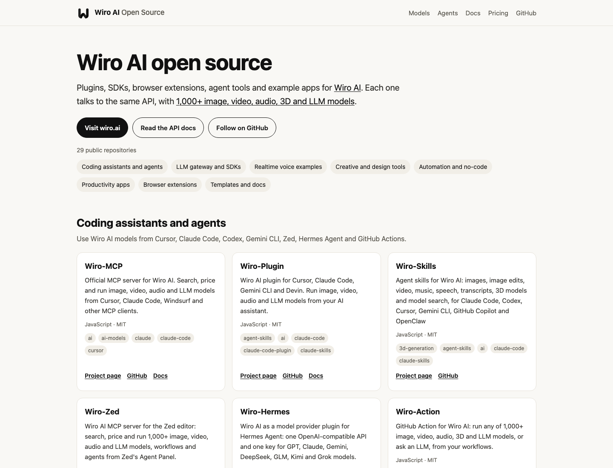
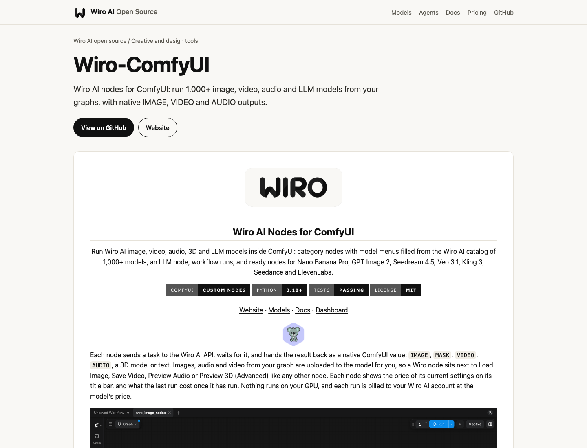

<div align="center">


# Wiro AI Open Source

The index of every open-source project from Wiro AI: plugins, SDKs, browser extensions, agent tools and example apps for one API with 1,000+ image, video, audio, 3D and LLM models.

[](https://wiroai.github.io) [](./LICENSE)

[Website](https://wiro.ai) · [Models](https://wiro.ai/models) · [Docs](https://wiro.ai/docs) · [Dashboard](https://wiro.ai/panel)

</div>

This repository builds [wiroai.github.io](https://wiroai.github.io). The home page lists the public repositories of the [wiroai](https://github.com/wiroai) organization by group, and every project has its own page with its README.





## How the site is built

`build.py` uses the GitHub CLI to read the organization's public repositories, renders each README with the GitHub Markdown API and writes plain HTML:

- `index.html`: every project, grouped
- `projects/<name>/index.html`: one page per repository
- `sitemap.xml`, `robots.txt` and `404.html`

To rebuild after a repository changes:

```bash
gh auth status
python3 build.py
```

A public repository that is not in `GROUPS` lands in "More projects", so a new repository shows up on the next build. GitHub Pages serves the files from `main`.

## More from Wiro AI

| Repository | What it is |
| --- | --- |
| [Wiro-Chromium-Extension](https://github.com/wiroai/Wiro-Chromium-Extension) | Wiro AI extension for Chrome, Edge, Opera and Brave |
| [Wiro-Firefox-Extension](https://github.com/wiroai/Wiro-Firefox-Extension) | Wiro AI add-on for Firefox |
| [Wiro-Safari-Extension](https://github.com/wiroai/Wiro-Safari-Extension) | Wiro AI extension for Safari on the Mac |
| [Wiro-Extension-Core](https://github.com/wiroai/Wiro-Extension-Core) | Shared core of the Wiro AI browser extensions |
| [Wiro-MCP](https://github.com/wiroai/Wiro-MCP) | Official MCP server for Wiro AI, [`@wiro-ai/wiro-mcp` on npm](https://www.npmjs.com/package/@wiro-ai/wiro-mcp) |
| [Wiro-Plugin](https://github.com/wiroai/Wiro-Plugin) | Wiro AI plugin for Cursor, Claude Code, Gemini CLI, Devin, Antigravity and Kiro |
| [Wiro-Skills](https://github.com/wiroai/Wiro-Skills) | Agent skills for images, image edits, video, music, speech, transcripts, 3D and model search |
| [Wiro-LLM](https://github.com/wiroai/Wiro-LLM) | Vercel AI SDK provider for chat, images, speech, transcription and video, [`@wiro-ai/wiro-llm` on npm](https://www.npmjs.com/package/@wiro-ai/wiro-llm) |
| [Swift-QuickStart](https://github.com/wiroai/Swift-QuickStart) | WiroKit, the Wiro AI SDK for iOS |
| [Kotlin-QuickStart](https://github.com/wiroai/Kotlin-QuickStart) | WiroKit, the Wiro AI SDK for Android |
| [Dart-QuickStart](https://github.com/wiroai/Dart-QuickStart) | Wiro AI SDK for Dart and Flutter, [`wiro` on pub.dev](https://pub.dev/packages/wiro) |
| [ReactNative-QuickStart](https://github.com/wiroai/ReactNative-QuickStart) | Wiro AI SDK for React Native and Expo, [`@wiro-ai/wiro-react-native` on npm](https://www.npmjs.com/package/@wiro-ai/wiro-react-native) |
| [Swift-Realtime](https://github.com/wiroai/Swift-Realtime) | Realtime voice AI example for iOS |
| [Kotlin-Realtime](https://github.com/wiroai/Kotlin-Realtime) | Realtime voice AI example for Android |
| [Dart-Realtime](https://github.com/wiroai/Dart-Realtime) | Realtime voice AI example for Flutter |
| [ReactNative-Realtime](https://github.com/wiroai/ReactNative-Realtime) | Realtime voice AI example for React Native |
| [n8n-nodes-wiro](https://github.com/wiroai/n8n-nodes-wiro) | One Wiro AI node for n8n with a searchable model picker, [`@wiro-ai/n8n-nodes-wiro` on npm](https://www.npmjs.com/package/@wiro-ai/n8n-nodes-wiro) |
| [Wiro-Dify-Plugin](https://github.com/wiroai/Wiro-Dify-Plugin) | Wiro AI plugins for Dify: the LLM gateway as a model provider, plus image, video, speech and music tools |
| [Wiro-ComfyUI](https://github.com/wiroai/Wiro-ComfyUI) | Wiro AI nodes for ComfyUI |
| [Wiro-Hermes](https://github.com/wiroai/Wiro-Hermes) | Wiro AI plugins for Hermes Agent: image, video, audio and 3D tools, plus the LLM gateway as a model provider |
| [Wiro-Zed](https://github.com/wiroai/Wiro-Zed) | Wiro AI MCP server extension for Zed |
| [Wiro-Action](https://github.com/wiroai/Wiro-Action) | GitHub Action for Wiro AI models and the LLM gateway, [on the GitHub Marketplace](https://github.com/marketplace/actions/wiro-ai-action) |
| [Wiro-Raycast](https://github.com/wiroai/Wiro-Raycast) | Wiro AI extension for Raycast: image and video generation, LLM chat and model search |
| [Wiro-WordPress](https://github.com/wiroai/Wiro-WordPress) | Wiro AI plugin for WordPress: featured images, image edits, alt text, narration and SEO suggestions |
| [Wiro-Obsidian](https://github.com/wiroai/Wiro-Obsidian) | Wiro AI plugin for Obsidian: images, video, speech, music, transcription and text tools |
| [Wiro-Blender](https://github.com/wiroai/Wiro-Blender) | Wiro AI add-on for Blender: text to 3D, image to 3D and textures |
| [Wiro-Figma](https://github.com/wiroai/Wiro-Figma) | Wiro AI plugin for Figma: images, vectors, image edits and text |
| [Wiro-Next-Starter](https://github.com/wiroai/Wiro-Next-Starter) | Next.js starter for Wiro AI: Playground, image, video and audio tools, and LLM chat, ready for Vercel and Railway |
| [Wiro-Docs](https://github.com/wiroai/Wiro-Docs) | Source of the Wiro AI API docs |

## License

MIT
